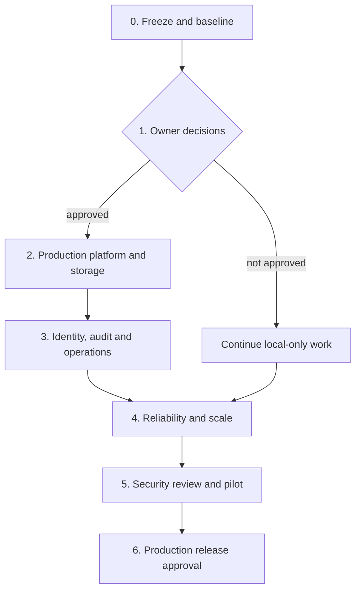

# ARGUS delivery roadmap

## Purpose and operating rule

ARGUS is a validated local investigation platform, not a production service yet.
This roadmap separates work that can proceed in the repository from decisions
that only the system owner can make. Each phase ends with evidence, a reviewed
pull request and a reversible deployment or test step. Do not expose evidence
or move real data to a third party while a decision gate is unresolved.

## Current baseline

The `codex/sprint3-validation` branch contains the validated local foundation:
authentication and roles, document quarantine/scanning/extraction/search,
quotas, append-only application audit events, administrator audit/session UI,
backup/restore drills, and recovery tests. GitHub Actions passed on commit
`898b2fe` on 2026-10-03. Local data and secrets remain outside Git.

## Workflow

## Phase 0 — Freeze and baseline

**Goal:** preserve a known-good starting point before new work.

- Keep `main` protected; use feature branches and pull requests from the
  validated branch.
- Require GitHub Actions, code review and a documented rollback path for every
  release candidate.
- Keep `.env`, `.env.runtime`, backups and evidence outside Git. Confirm secret
  scanning and repository access before inviting collaborators.
- Record an inventory of current volumes, images, database migration revision
  and backup location before any infrastructure migration.

**Exit evidence:** protected-branch settings, a named release candidate, a fresh
local backup, and successful CI for that exact commit.

## Decision gate 1 — owner choices

These choices are required before production infrastructure can be built:

| Decision | What must be chosen | Why it blocks later work |
| --- | --- | --- |
| Hosting | Provider, region, domain, budget and ownership account | Determines network, costs and deployment automation. |
| Identity | Authenticator-app MFA plus recovery codes, or an organization identity provider | Changes login, enrollment and account-recovery design. |
| Evidence storage | Supported provider, encryption ownership, region and retention schedule | Real evidence must not be moved without approval. |
| Recovery | RPO, RTO, backup frequency and off-site retention | Defines backup architecture and drill acceptance criteria. |
| Governance | Authorized users, incident contact, privacy/legal retention requirements | Defines access, audit and deletion rules. |

Until this gate is complete, only local-safe engineering and synthetic-data tests
may continue. Record the approved answers in a deployment decision record; do
not put account credentials into that document or Git.

## Phase 2 — production platform and storage

**Goal:** deploy an isolated, repeatable environment without migrating evidence
until recovery is proven.

1. Create separate development, staging and production environments with distinct
   databases, buckets, credentials and domains.
2. Configure TLS ingress, strict HTTPS, production CORS/allowed-host values, a
   secret manager and least-privilege runtime/migration identities.
3. Replace or migrate the archived MinIO production dependency to the approved,
   supported object store. Test quarantine and promoted objects, metadata,
   access controls, backup, restore and rollback using synthetic data first.
4. Configure encrypted off-site backups, retention, failure alerts and a
   scheduled isolated restore drill. Keep backup encryption keys separate from
   the backup location.
5. Define CI/CD promotion: build immutable images, scan the exact target
   architecture, deploy to staging, run smoke tests, then require approval for
   production.

**Exit evidence:** staging deployment, HTTPS checks, secret rotation drill,
synthetic storage migration/rollback, and a successful off-site restore drill
within the agreed RPO/RTO.

## Phase 3 — identity, audit and operations

**Goal:** make access and accountability suitable for the approved policy.

1. Implement the selected MFA path: enrollment, enforced challenge, recovery,
   reset/lockout rules and administrator recovery procedure. Never enable MFA
   enforcement without tested recovery paths.
2. Complete account lifecycle controls: invitation/provisioning, deactivate,
   reactivation approval and session/device visibility as policy requires.
3. Send immutable audit copies to the approved independent retention service.
   Add approved event coverage for authorization denials, refresh rejection,
   CLI administration, evidence viewing/download and sensitive settings changes.
4. Give migration jobs credentials that are separate from API/worker runtime
   credentials; restrict their availability to controlled deployment jobs.
5. Add monitoring, structured alert routing, runbooks and on-call ownership for
   API health, ingestion failures, queue backlog, storage errors, backup errors,
   audit-sink errors and authentication anomalies.

**Exit evidence:** MFA/recovery tests, access-control review, audit-sink delivery
test, least-privilege database tests, alert delivery test and approved runbooks.

## Phase 4 — reliability and scale

**Goal:** eliminate known crash windows and prove expected load behavior.

1. Add idempotency keys/content-deduplication policy for intake and test client
   retries, duplicate notifications and interrupted processing.
2. Add a safe orphan-object reconciler with dry-run reporting, an approval step
   and a rollback window; never delete objects solely from a timed job without
   reconciliation evidence.
3. Move large document and audit lists from offset pagination to signed cursor
   pagination with stable ordering and a migration-compatible API transition.
4. Measure representative upload/OCR/search/queue load on staging. Set worker,
   database, Redis and storage limits from measured results rather than guesses.
5. Extend compatibility checks for supported browsers, document types and OCR
   languages. Publish explicit unsupported-input behavior.

**Exit evidence:** load report, retry/duplicate test results, dry-run and approved
orphan cleanup report, cursor migration tests and documented capacity limits.

## Phase 5 — security review and pilot

**Goal:** authorize a limited release based on evidence, not feature completion.

1. Triage every HIGH/CRITICAL container finding against the exact deployment
   images. Update supported bases where possible; document compensating controls
   only when a qualified reviewer accepts them. The current API image scan is
   not a release waiver.
2. Run an independent security review covering authentication, authorization,
   file handling, object access, backup recovery, deployment secrets and audit
   integrity.
3. Test incident response: revoked credentials, suspected evidence exposure,
   restore from off-site backup and service rollback.
4. Start a small authorized-user pilot with monitoring, support ownership and
   a defined rollback decision.

**Exit evidence:** signed findings disposition, completed remediation or accepted
risk record, pilot results, incident drill evidence and explicit release approval.

## Phase 6 — production release and ongoing work

**Goal:** release only after every gate is accepted.

- Approve the exact image digests, migration revision, backup recovery evidence
  and deployment plan.
- Migrate real data only through the approved storage/runbook path.
- Monitor closely during the initial release window; retain a tested rollback
  route and do not delete the prior environment until acceptance is complete.
- Repeat image scans, restore drills, access reviews and security reviews on a
  fixed schedule determined by the owner’s policy.

## Recommended execution order now

1. Complete Decision Gate 1.
2. Create staging and the approved storage/backup path.
3. Implement MFA and independent audit retention in parallel only after the
   identity and retention choices are approved.
4. Complete reliability/scale work against staging.
5. Run the external security review, then a controlled pilot.

This sequence deliberately avoids treating local success or passing CI as a
production authorization.
